# AI Customer Support Resolution Sandbox

[](https://github.com/Saurabh-Code88/AI-customer-support/actions/workflows/ci.yml)

This project is a customer support resolution sandbox built with FastAPI, LangGraph, Gemini, and Groq: it turns a customer ticket into a structured workflow that retrieves a seeded order and support policy, asks an LLM to propose an action, checks that proposal in deterministic Python policy code, pauses for agent approval when required, then executes and records the outcome. The repository includes a browser dashboard, role-scoped demo sessions, persistent tickets and audit events, resumable approval checkpoints, and idempotent demo refunds; it is intended to show the design and behavior of a support workflow, not to process real orders or customer data.

**Live demo:** [Deployment URL to be added](#live-demo-url) <!-- TODO: replace this placeholder after a deployment exists. -->

## Screenshots

<!-- TODO: Add a captured customer dashboard screenshot at docs/screenshots/customer-dashboard.png. -->

Customer dashboard screenshot placeholder.

<!-- TODO: Add a captured agent dashboard screenshot at docs/screenshots/agent-dashboard.png. -->

Support agent dashboard screenshot placeholder.

<!-- TODO: Add a short workflow GIF at docs/screenshots/ticket-workflow.gif. -->

Ticket workflow GIF placeholder.

## Architecture

```mermaid
flowchart LR
    Browser[Customer or agent dashboard] --> API[FastAPI API and session roles]
    API --> Graph[LangGraph workflow]
    Graph --> Classify[Classify request]
    Classify --> Retrieve[Retrieve seeded order and policy]
    Retrieve --> Decide[LLM proposes action]
    Decide --> Policy[Deterministic policy.py check]
    Policy -->|Allowed| Tool[Database-backed support tool]
    Policy -->|Approval required| Approval[Agent approval interrupt]
    Approval --> Tool
    Policy -->|Denied or ambiguous| Respond[Respond or escalate]
    Tool --> Respond
    Respond --> Store[(SQLAlchemy database)]
    Graph -. resumable state .-> Checkpoint[(LangGraph checkpointer)]
    API --> Store
    Store --> Orders[Demo orders, tickets, audit, refunds]
```



For local development, SQLite stores application data and graph checkpoints. Set `DATABASE_URL` to use PostgreSQL. The graph's model calls use Gemini and Groq; the `FakeLLM` test suite runs without provider credentials.

## Quick start with Docker

Requirements: Docker Engine and the Docker Compose plugin.

```sh
git clone https://github.com/Saurabh-Code88/AI-customer-support.git
cd AI-customer-support
```

Copy `.env.example` to `.env`, set `GOOGLE_API_KEY` and `GROQ_API_KEY` if you want to process model-backed tickets, and replace `AUTH_JWT_SECRET` with a random local secret. The checked-in example contains development-only defaults, not production credentials. Then run:

```sh
docker compose up --build
```

Open <http://localhost:8000>. The container applies migrations and seeds demo orders on startup. Check `/health` for process liveness and `/ready` for database readiness. The demo supports five seeded customers and an agent role; use only its fake data. See [DEPLOY.md](./DEPLOY.md) for environment configuration and container-host notes.

## API reference

Interactive OpenAPI documentation is available at `/docs` while the app is running. Start a session with `POST /auth/session`, then send its bearer token in the `Authorization` header. Customer identity comes from the signed session, not the ticket body.

| Method | Endpoint | Access | Purpose |
|---|---|---|---|
| `POST` | `/auth/session` | Public | Issue a short-lived customer or agent demo session |
| `GET` | `/auth/customers` | Public | List the seeded customer choices |
| `POST` | `/tickets` | Customer | Submit a ticket and wait for completion or approval |
| `POST` | `/tickets/stream` | Customer | Submit a ticket with graph progress events |
| `GET` | `/tickets` | Customer or agent | List tickets; customer results are scoped to that customer |
| `GET` | `/tickets/{id}` | Customer or agent | Read ticket status, details, and audit trail |
| `GET` | `/agent/approvals` | Agent | List pending approval requests |
| `POST` | `/tickets/{id}/approval` | Agent | Approve or reject a pending request |
| `GET` | `/analytics` | Agent | Read ticket resolution metrics |
| `GET` | `/demo/orders` | Agent | View seeded demo orders |
| `POST` | `/demo/reset` | Agent | Reset demo order data (session-limited) |
| `GET` | `/health` | Public | Process liveness |
| `GET` | `/ready` | Public | Database readiness |

Example session and ticket request:

```sh
curl -X POST http://localhost:8000/auth/session \
  -H 'Content-Type: application/json' \
  -d '{"role":"customer","customer_email":"a@example.com"}'

# Copy access_token from the session response.
curl -X POST http://localhost:8000/tickets \
  -H 'Authorization: Bearer YOUR_SESSION_TOKEN' \
  -H 'Content-Type: application/json' \
  -d '{"message":"Where is order A1001?"}'
```

Ticket submission is limited to 2,000 characters. API keys are needed to process tickets with the real providers; missing provider configuration is not replaced by a live-model mock at runtime.

## Tests and evals

Run the offline test suite (no LLM API keys required):

```sh
PYTHONPATH=src pytest -q
```

Run lint:

```sh
ruff check --config ruff.toml .
```

The provider-backed eval suite uses the credentials in the environment and can incur provider usage:

```sh
python evals/run_evals.py --sleep 3
```

**Recorded Task 6 verification:** 63 tests passed; the real-provider eval run passed 19/19 cases (100%). These are the recorded results from that verification pass, not a promise that a later run will be identical. Provider responses, quotas, and availability can change.

## Design decisions

- **Deterministic policy:** The LLM proposes an action; Python code in `policy.py` enforces identity, eligibility, refund limits, and allowed tools. This keeps business rules testable and independent of model wording.
- **LangGraph:** The explicit graph makes classification, retrieval, decision, policy, tools, and response visible as separate steps. Its persistent checkpointer allows an approval interrupt to resume after a restart.
- **Human in the loop:** Refunds above the configured automatic limit pause for an agent decision before the tool executes. This gives higher-impact actions an explicit review point.
- **Idempotent refunds:** A refund operation is keyed by ticket and order so a retry after a timeout returns the original result instead of applying the refund twice.

## Known limitations and production roadmap

This is a portfolio sandbox using five seeded demo orders and a local database-backed mock order system. A successful refund updates that demo state; it does not contact a payment processor or merchant order system. The values shown for demo orders are numeric examples: the data model does not define a currency, so they must not be interpreted as USD or any other currency.

The role picker issues short-lived demo JWTs, but it is not real customer identity verification or enterprise authorization. Anyone using the public sandbox can choose one of the seeded customer identities and the demo agent role. Do not enter real personal information. Gemini and Groq free-tier availability, quotas, pricing, and terms can change; check current provider terms and usage limits before running evals or hosting the app.

Before serving real customers, the system would need authenticated identity integrated with the customer account system, narrowly scoped agent permissions, a production order and payment integration with provider-side idempotency, explicit currency and refund accounting, durable shared storage and concurrency controls, operational monitoring and alerting, privacy/retention controls, and security review. The current mock data, demo authentication, policy examples, and deployment configuration are not a certification of production readiness.

## Resume bullet suggestions

- Built a LangGraph support workflow using Gemini and Groq for classification and action proposals, with deterministic Python policy checks before any tool execution.
- Implemented a FastAPI dashboard and role-scoped demo API with short-lived JWT sessions, customer ticket isolation, and human approval for high-value refunds.
- Added SQLAlchemy/Alembic persistence for tickets, audit events, demo orders, and idempotent refunds, plus persistent LangGraph checkpoints for approval recovery.
- Added offline regression tests and provider-backed evals; the recorded verification run had 63 passing tests and 19/19 eval cases passing.

## License

Released under the MIT License; see [LICENSE](./LICENSE).
